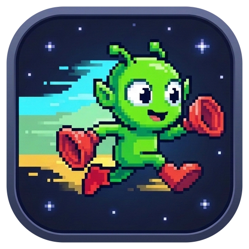

<h3 align="center">
	<br/>
	cosmo-smooth — Smooth Scrolling for <em>Cosmo's Cosmic Adventure</em>
</h3>
<p align="center">
    <a href="https://github.com/notnout/cosmo-smooth/stargazers"></a>
    <a href="https://github.com/notnout/cosmo-smooth/issues"></a>
    <a href="https://github.com/notnout/cosmo-smooth/releases"></a>
    <a href="https://github.com/notnout/cosmo-smooth/blob/main/LICENSE"></a>
</p>


https://github.com/user-attachments/assets/efbd7969-9dc6-48bd-a90c-5cecbaa238a4

<sub><b>Before vs. After (60 FPS capture):</b> click to watch <a href="docs/comparison.mp4"><code>docs/comparison.mp4</code></a> — Original 10.8 FPS (left) vs. <code>cosmo-smooth</code> 70 Hz (right).</sub>


## About cosmo-smooth

A **32-bit MS-DOS** smooth-scrolling build of ***Cosmo's Cosmic Adventure*** (Apogee, 1992) designed for **DOSBox Pure (RetroArch)**, DOSBox Staging, DOSBox-X, and 32-bit DOS environments.

The original 1992 EGA game scrolls in chunky 8-pixel tile jumps at ~10.8 FPS. `cosmo-smooth` keeps the exact original 10.8 Hz gameplay logic and physics intact while compositing **70 Hz pixel-smooth frames** in VGA Mode 13h (`320×200`) with:

- Pixel-smooth camera scrolling and half-speed parallax backdrop interpolation
- Smooth Cosmo movement with per-pixel foreground terrain occlusion
- Smooth spinning collectible stars, blast rings, rising pickups, shards, debris, and hazard animations
- Authentic hardware AdLib (OPL2) music, PC speaker SFX, and VGA DAC palette fades/flashes
- Self-contained 32-bit protected-mode executables (CauseWay extender stubbed in — no external `DOS4GW.EXE` or `CWSDPMI.EXE` required)

---

## Quick Start (Prebuilt Open-Source EXEs Included)

This repository includes prebuilt open-source executables in [`bin/`](bin/) (`COSMO1.EXE`, `COSMO2.EXE`, `COSMO3.EXE`). Original game data files (`.STN` / `.VOL`) are copyrighted by Apogee Software and are **not** included — supply your own shareware or registered episode files.

### 1. Package your episode data for DOSBox Pure / RetroArch

Drop your original `COSMO1.STN` + `COSMO1.VOL` (and optionally Episodes 2 & 3 — either extracted files or your original `.zip` archives) into [`gamedata/`](gamedata/), then run:

```bash
./package.sh
```

*(You can also point `package.sh` at an existing folder without copying files: `./package.sh /path/to/your/cosmo-files`.)*

Ready-to-play ZIP archives will be generated in `dist/`:
- `dist/cosmo-smooth-ep1.zip`
- `dist/cosmo-smooth-ep2.zip`
- `dist/cosmo-smooth-ep3.zip`
- `dist/cosmo-smooth-all-episodes.zip` (when multiple episodes are present)

Or manually copy `bin/COSMO1.EXE` (and/or `COSMO2.EXE`, `COSMO3.EXE`) into the same directory as your `COSMOn.STN` and `COSMOn.VOL` files.

### 2. Playing in RetroArch (DOSBox Pure)

Load any generated `.zip` directly in RetroArch using the **DOSBox Pure** core.

- **Performance:** In **Quick Menu → Core Options → Performance**, ensure **Emulated Performance** is set to **Auto** or **Pentium / Max** so the 70 Hz compositor has full CPU headroom.
- **Spacebar / Keyboard Hotkeys (macOS & PC):** RetroArch binds `Space` to **Fast-Forward (Toggle)** by default, which can conflict with Jump. To pass all keys directly to Cosmo:
  1. Enable **Settings → User Interface → Show Advanced Settings → ON**.
  2. Set **Settings → Input → Auto Enable 'Game Focus' Mode → Detect** (or **On**).
  3. On macOS (no Scroll Lock key), bind **Settings → Input → Hotkeys → Game Focus (Toggle)** to an unused key such as `F12` (or clear `Space` under **Hotkeys → Fast-Forward (Toggle)**).

---

## Controls & Command-Line Options

| Key / Flag | Action |
|---|---|
| Arrow keys | Move / look up & down |
| `Space` | Jump *(rebindable in **Game Settings → Keyboard Mapping**)* |
| `Alt` | Drop bomb |
| `[` | Toggle **Smooth 70 Hz** / **Classic 11 Hz** live during gameplay |
| `]` | Toggle **Normal** / **Turbo** tick pacing live during gameplay |
| `F1` | In-game help & **Game Settings → Display Filter** toggle |
| `--classic` / `/classic` | Start in classic 11 Hz EGA-paced mode |
| `--turbo` / `/turbo` | Start in Turbo tick mode (~14 Hz logic) |
| `--diag` / `/diag` | Write FPS diagnostics (`COSMO.LOG`) and framebuffer captures (`SNAP1.PPM`, `SNAP2.PPM`) |

---

## Building from Source

`cosmo-smooth` cross-compiles to 32-bit MS-DOS using **[Open Watcom v2](https://github.com/open-watcom/open-watcom-v2/releases/tag/Current-build)**. No other libraries or SDKs are required — all three executables are written to `bin/COSMO1.EXE`, `bin/COSMO2.EXE`, and `bin/COSMO3.EXE`.

### macOS (Apple Silicon & Intel)

```bash
# 1. Download and extract Open Watcom v2 (includes native arm64 & x86_64 binaries)
mkdir -p ~/watcom
curl -fL "https://github.com/open-watcom/open-watcom-v2/releases/download/Current-build/ow-snapshot.tar.xz" -o /tmp/ow-snapshot.tar.xz
tar -xJf /tmp/ow-snapshot.tar.xz -C ~/watcom
rm /tmp/ow-snapshot.tar.xz

# 2. Clear macOS Gatekeeper quarantine on the extracted compiler binaries
xattr -dr com.apple.quarantine ~/watcom

# 3. Build COSMO1.EXE, COSMO2.EXE, and COSMO3.EXE
export WATCOM="$HOME/watcom"
./build.sh
```

### Linux (x86_64 & ARM64)

```bash
# 1. Download and extract Open Watcom v2
mkdir -p ~/watcom
curl -fL "https://github.com/open-watcom/open-watcom-v2/releases/download/Current-build/ow-snapshot.tar.xz" -o /tmp/ow-snapshot.tar.xz
tar -xJf /tmp/ow-snapshot.tar.xz -C ~/watcom
rm /tmp/ow-snapshot.tar.xz

# 2. Build COSMO1.EXE, COSMO2.EXE, and COSMO3.EXE
export WATCOM="$HOME/watcom"
./build.sh
```

### Windows (x64 / x86)

1. Install Open Watcom v2 from the [Open Watcom v2 Current-build releases](https://github.com/open-watcom/open-watcom-v2/releases/tag/Current-build) (either run `open-watcom-2_0-c-win-x64.exe` into `C:\watcom`, or extract `ow-snapshot.tar.xz` to `C:\watcom`).
2. Build using **Command Prompt** (`cmd.exe`):

   ```bat
   set WATCOM=C:\watcom
   build.bat
   ```

   Or using **PowerShell**:

   ```powershell
   $env:WATCOM = "C:\watcom"
   .\build.bat
   ```

   Or using **Git Bash / MSYS2**:

   ```bash
   export WATCOM="/c/watcom"
   ./build.sh
   ```

---

## License & Credits

All source code in this repository is licensed under the [MIT License](LICENSE). See [ATTRIBUTION.md](ATTRIBUTION.md) for full credits to the original 1992 Apogee team and the open-source projects (`Cosmore`, `digows/cosmo`, `Cosmo Enhanced`, Open Watcom / CauseWay) that made this possible.
